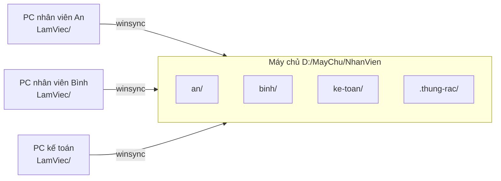

# win-file-sync

[](https://github.com/ferbdev-byte/win-file-sync/actions/workflows/ci.yml)


Đồng bộ **một chiều** thư mục làm việc của từng nhân viên về **máy chủ trung tâm**, tự chia mỗi người một thư mục. Viết cho môi trường văn phòng chạy thuần Windows: không cần Linux, không cần dịch vụ đám mây, chỉ Python.



## Vì sao không dùng robocopy /MIR?

`robocopy /MIR` xoá thẳng ở đích khi file mất ở nguồn: nhân viên lỡ xoá một file là máy chủ cũng mất theo. `winsync` được thiết kế cho đúng tình huống đó:

| Đảm bảo | Cách làm |
|---|---|
| Không bao giờ đụng vào máy nhân viên | Chỉ đọc nguồn; có test kiểm tra nguồn không đổi một byte, không đổi mtime |
| File lỡ xoá vẫn lấy lại được | File mất ở nguồn được chuyển vào `.thung-rac/<thời điểm>/` trên máy chủ, giữ 30 ngày |
| Mất điện giữa chừng không hỏng file | Chép ra file tạm rồi `os.replace` (nguyên tử trên NTFS) |
| Không lọt bí mật lên máy chủ chung | Tự chặn file tên giống `mat-khau`, `token`, `.env`, `.pem`, `.kdbx`… |
| Không rác | Bỏ qua `~$*.xlsx` (khoá tạm Office), `Thumbs.db`, `desktop.ini`, thư mục ẩn |
| Một file lỗi không làm dừng cả lượt | File đang bị khoá được ghi vào báo cáo lỗi, lượt sau chép tiếp |
| Kiểm tra toàn vẹn | `"verify": true` so SHA-256 sau mỗi lần chép |

## Cài đặt

```powershell
pip install git+https://github.com/ferbdev-byte/win-file-sync
```

## Dùng

Tạo `config.json` (xem [examples/config.json](examples/config.json)):

```json
{
  "hub": "D:/MayChu/NhanVien",
  "users": {
    "an": "\\\\PC-AN/LamViec",
    "ke-toan": "C:/Users/KeToan/Documents/LamViec"
  },
  "verify": true,
  "interval": 300
}
```

```powershell
winsync run -c config.json --dry-run   # xem trước sẽ chép gì
winsync run -c config.json             # chạy một lượt
winsync watch -c config.json           # chạy liên tục mỗi 5 phút
```

Mỗi người có thể tự đặt file `.winsyncignore` trong thư mục của mình, mỗi dòng một mẫu (giống `.gitignore`) để bỏ qua thư mục nháp hay file không cần đẩy lên:

```
# thư mục nháp của tôi
Ban nhap
*.psd
winsync plan -c config.json            # xuất kế hoạch dạng JSON cho công cụ khác
```

Ví dụ đầu ra:

```
09:00:01 INFO [an] 12 file (4 MB), 1 vào thùng rác, 0 lỗi
09:00:02 INFO [ke-toan] 3 file (820 KB), 0 vào thùng rác, 0 lỗi
```

Muốn chạy nền 24/24 khi máy chủ khởi động, dùng kèm [win-service-kit](https://github.com/ferbdev-byte/win-service-kit).

## Dùng như thư viện

```python
from winsync import sync, IgnoreRules

res = sync("C:/LamViec", "D:/MayChu/an", rules=IgnoreRules(extra=["*.bak"]), verify=True)
print(res.copied, res.trashed, res.errors)
```

## Phát triển

```powershell
pip install -e ".[dev]"
ruff check .
pytest
```

CI chạy trên Windows và Ubuntu, Python 3.10 và 3.12.

## Giấy phép

MIT
